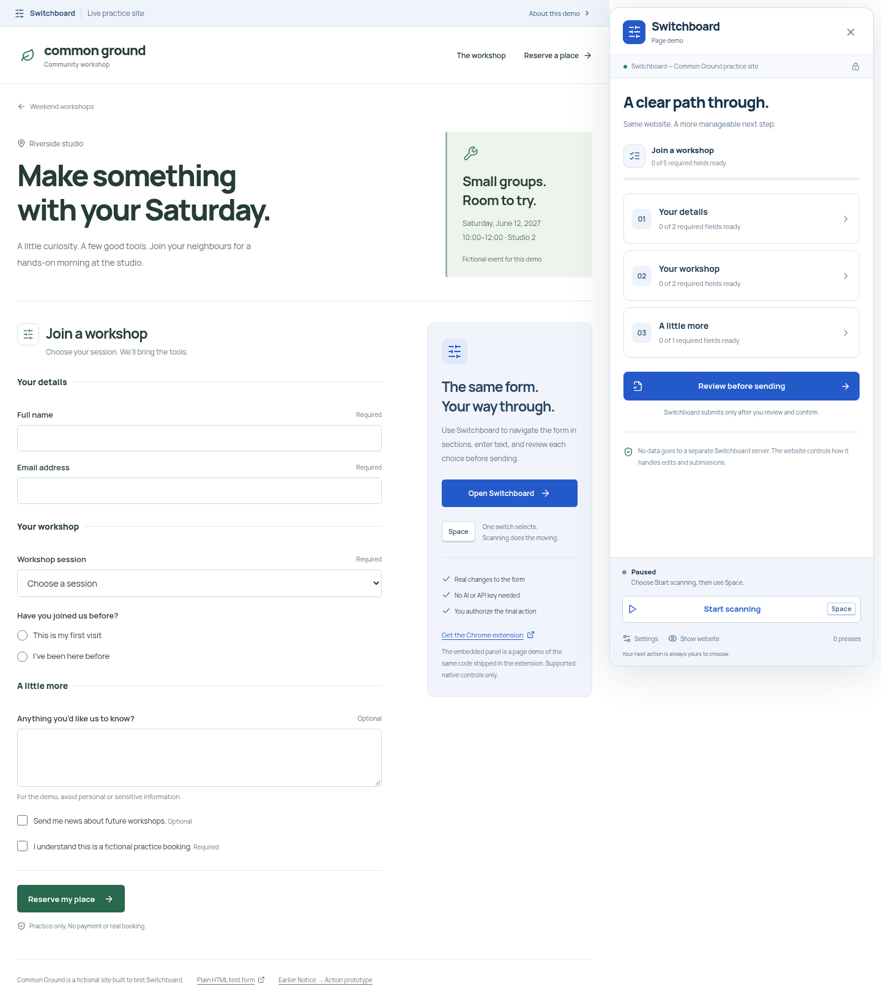

# Switchboard

**Complete supported web forms with one switch.**

Switchboard is a Chrome/Chromium extension that turns a native form into a structured, user-controlled task view. Navigate section → field → choice or keyboard row → character. Changes reach the actual website, validation errors come back from the website, and submission requires an explicit review and confirmation.



## Three-minute demo film

[Watch/download the 1080p MP4](docs/demo/switchboard-demo.mp4) · [English subtitles](docs/demo/switchboard-demo.srt) · [Transcript](docs/demo/transcript.txt)

Exactly 3:00, with installed-extension footage, synthetic narration, original music, clear scan-timing disclosures and burned-in captions. To open the local player: `uv run uvicorn scripts.demo.serve:app --port 8004`, then visit http://127.0.0.1:8004. Production sources and recording notes are in `scripts/demo/` and `docs/demo/production-notes.md`.

## Try it locally

Requires **Python 3.11+**, [uv](https://docs.astral.sh/uv/), and **Node 22.6+** (24 recommended). No AI or API key is required.

From the project root:

```bash
uv sync
npm --prefix frontend ci
npm --prefix frontend run build
uv run uvicorn backend.main:app --host 127.0.0.1 --port 8000
```

Open **http://127.0.0.1:8000** and select **Open Switchboard**. This opens a page demo of the same adapter and panel shipped in the extension. It is labeled **Page demo**, not passed off as an installed extension.

The Common Ground workshop site is fictional but functional: a normal controlled React form submits to an independent Python registration API. No special autofill channel connects the site to Switchboard. Use fictional details. The server returns a receipt but does not create a real booking, send an email, or retain a registration database.

**Try an actual recovery:** choose the laser-cutting workshop, complete the required fields, review, and confirm. The server rejects the full session. Switchboard reads the site's field error. Choose sewing or repair, review again, and confirm to receive a practice receipt.

## Install the real extension

The build produces:

- `frontend/extension-dist/` — loadable, unpacked extension.
- `frontend/dist/switchboard-extension.zip` — downloadable distributable (also available at `/switchboard-extension.zip` while the server runs).

In Chrome or Chromium:

1. Open `chrome://extensions` and enable **Developer mode**.
2. Select **Load unpacked** and choose `frontend/extension-dist/` (or extract the ZIP and select its directory).
3. Open the practice site, or a supported webpage containing a native form.
4. Click Switchboard in the browser's extension toolbar/menu. The panel is labeled **Browser extension**.

The shipped Manifest V3 extension requests **only `activeTab` and `scripting`**, with no blanket host permissions, storage permission, background browsing, or external connections. Activation is per user toolbar click. Browser-internal pages, extension stores, and file URLs are not supported.

After rebuilding, reload the extension in `chrome://extensions` and reload the webpage before testing the new bundle. It is not published to a browser extension store.

## One-switch controls

- The panel starts paused, with **Start scanning** focused. Press **Space** to start.
- Automatic scanning highlights and focuses one target at a time. **Space selects** that target.
- Choose a section, then a field. For text, choose a keyboard row and then a character. No sample autofill is needed.
- **Pause scanning** is part of every scan cycle. Select it with the same switch. **Escape** is an additional emergency pause.
- In **Settings**, choose 0.8, 1.2, or 1.8 seconds per target. Activity and undo are available there too.
- **Show website** temporarily collapses the panel. Press Space to return.
- A switch configured to emulate Space uses the same input path. Physical switch hardware has not been independently tested.
- With scanning paused, ordinary keyboard/mouse entry is also available.

Most text edits synchronize immediately. Native **number/date** fields use a clearly labeled draft because browsers discard incomplete values; choose **Done** to apply a complete number or `YYYY-MM-DD` date. Back discards that draft. Required/range validation still belongs to the website.

## Supported scope and honest limits

### Supported
- Visible, top-document HTML forms with a single labeled native submit button.
- Native text, email, tel, URL, search, number, and date inputs; textareas; single-choice selects; checkboxes; radio groups.
- Explicit labels (`label`, `aria-label`, `aria-labelledby`), fieldset grouping, required state, native validation, and `aria-invalid` with described error text.
- Normal native controls and controlled React inputs, tested in both page and extension isolated worlds.
- DOM updates, stale-control rejection, source-page value updates, and stale-review protection.

### Not supported or not claimed
- Passwords, file uploads, payment-autocomplete fields, one-time codes, custom ARIA widgets, multi-selects, CAPTCHAs, iframe forms, shadow-root forms, or multiple competing submit actions. Detected unsupported controls prevent Switchboard submission.
- A universal website accessibility repair, accessibility-compliance certification, or reliable interpretation of unlabeled controls. Fallback labels are explicitly identified.
- Guaranteed compatibility with every framework/site. Websites may reject synthetic events or change behavior when fields are edited. Test each target site.
- A full international input method. The scanning keyboard covers English letters, digits, and common punctuation; other characters can be entered with an ordinary keyboard while paused. This limits who can complete every task through one switch.
- Undoing a radio selection back to an originally empty controlled group. The panel reports this limitation without claiming a change occurred. Restoring an earlier selected option is supported.
- Measured speed gains, universal usability, or endorsement from disabled users. Those require actual user testing; automated tests are not a substitute.

The panel counts actual switch activations, applied edit actions, and authorized submissions. These are local session counters—not invented time-saved metrics. The automated one-switch test accelerates scan timers; it does not measure human completion speed.

## Privacy and safety

The extension makes **no network requests**, uses no AI, and stores no form values or history in browser storage. Values, drafts, and undo entries exist in memory while the panel is open and are released on closing. The short activity list records field labels/actions, not entered values. The host page can see the panel's open Shadow DOM; this is not a secure enclave from that website.

**The website remains responsible for its own data handling.** Editing a field triggers normal input/change events, which some sites may autosave or transmit before submission. Switchboard itself calls `requestSubmit` only after explicit review and confirmation; it does not prevent the site's own scripts from reacting to edits.

A review captures a fingerprint of the actual form/controls. Changes require a fresh review. Source feedback is displayed as **Website says**; Switchboard never invents success. Standard website behavior, including navigation, still applies after confirmation. Do not use this prototype for banking, medical, identity, or other sensitive transactions.

The app may reserve space by temporarily adjusting the source body's right padding on desktop. Closing restores the prior inline padding. Complex/fixed website layouts may still need the collapsed website view.

## Development

Run the API and Vite in separate terminals:

```bash
uv run uvicorn backend.main:app --reload --port 8000
```

```bash
npm --prefix frontend run dev
```

Open http://127.0.0.1:5173. Vite proxies `/api` to the Python server. The extension is built separately by `npm run build`; it is not hot-reloaded into Chrome.

## Tests

```bash
uv run pytest -q
npm --prefix frontend test
npm --prefix frontend run test:e2e
npm --prefix frontend run test:adapter
npm --prefix frontend audit
```

First install a Playwright browser:

```bash
cd frontend
npx playwright install --with-deps chromium
```

On NixOS, use native Chromium instead of a generic downloaded Linux executable:

```bash
PLAYWRIGHT_CHROMIUM_EXECUTABLE_PATH="$(command -v chromium)" npm run test:e2e
PLAYWRIGHT_CHROMIUM_EXECUTABLE_PATH="$(command -v chromium)" npm run test:adapter
```

The existing `devenv.nix` provides Python, uv, Node and native Ruff. Optional lint: `uv run ruff check backend tests scripts`; on NixOS use `nix run nixpkgs#ruff -- check backend tests scripts`.

### What the tests prove
- Actual native and React page values change, including checkboxes/radio groups/selects.
- A real registration request is rejected by the server, corrected, and accepted after a new explicit confirmation.
- A full registration and server-error recovery use only Space key presses after opening the panel, including spelling the name/email through the row-column keyboard.
- Replaced controls, disabled options, sensitive inputs and stale reviews are handled safely.
- The actual unpacked extension loads in Chromium and updates controlled React fields from its isolated world. A **temporary test-only manifest** grants only the local fixture origin so automation can invoke injection without physically clicking the browser toolbar; the distributed manifest keeps activeTab-only access.
- Source and panel home/editor/settings states pass automated axe checks; mobile panel layout and collapse/return work. This is not a full accessibility audit.

Browser suites use isolated local ports 8001 (built app) and 8002/5174 (adapter tests). Set `UPDATE_SCREENSHOTS=1` during `test:e2e` to refresh screenshots.

## Files

```text
frontend/src/switchboard/   Shared DOM adapter, scanning panel, keyboard, practice site
frontend/extension/        Minimal Manifest V3 and toolbar service worker
frontend/extension-dist/   Generated unpacked extension (ignored)
frontend/e2e/              Native/React, one-switch, accessibility, extension tests
backend/registration.py   Independent fictional workshop API
scripts/package_extension.py  Local extension packaging and icons
README.md                 Setup and honest support/privacy boundaries
docs/switchboard-design.md Product, visual direction and architecture
docs/submission.md        Devpost draft and demo script
docs/screenshots/         Switchboard and preserved earlier screenshots
```

## Earlier prototype

Notice → Action is preserved at **`/notice`**, with its original analysis API and tests. Its AI settings in `.env.example` are unrelated to Switchboard and are not needed for this project. See [the archived setup](docs/notice-to-action-setup.md) and [earlier submission draft](docs/notice-to-action-submission.md). Keep it separate when submitting Switchboard.
