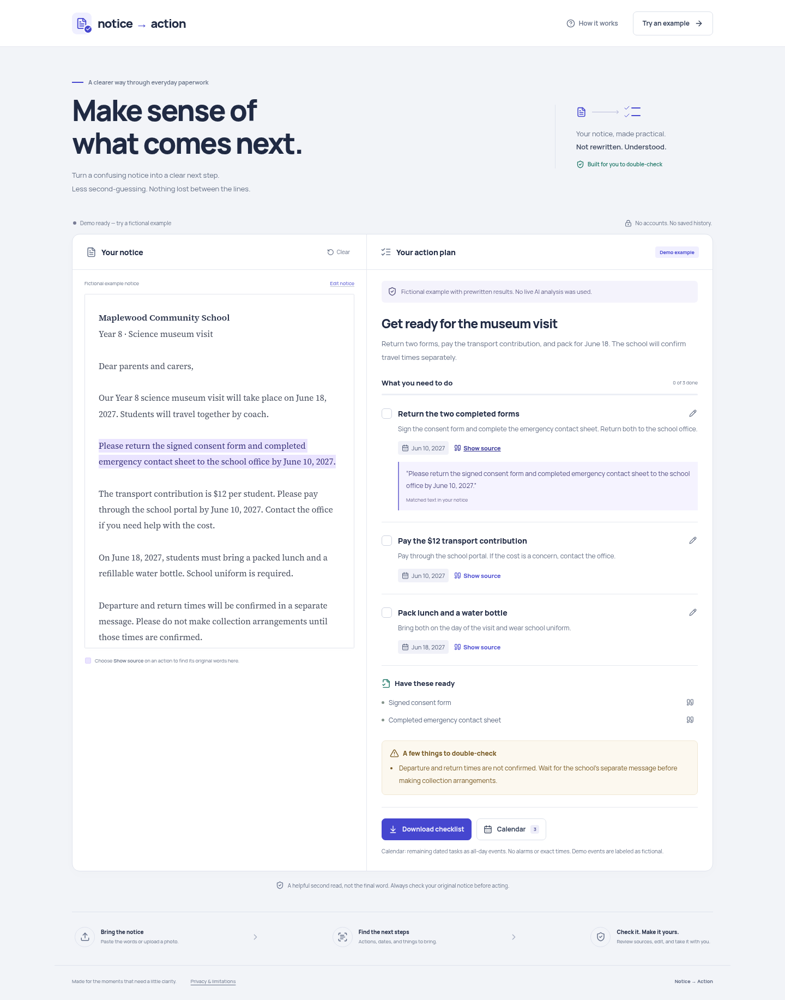

# Notice → Action

**Turn a confusing notice into a clear, source-backed action plan.**

School letters, maintenance notices, and appointment confirmations often hide simple next steps in dense paragraphs. Notice → Action extracts a reviewable checklist, explicit dates, required documents, and details that need clarification—while keeping the original notice visible.



> Archived earlier prototype. In the combined project, open `/notice`, not `/`, to use this interface. Switchboard is now the default project.

## What works

- Paste notice text or upload a JPEG, PNG, or WebP photo.
- Get plain-language actions and required documents with clickable source quotations.
- Highlight the corresponding words in the original notice.
- Extract dates only when an explicit, matching full date including a year appears in the supporting text. Ambiguous dates are left for review.
- Edit task titles/dates, mark tasks done, and download a text checklist.
- Download remaining dated tasks as all-day `.ics` calendar entries. No exact-time reminders or alarms are created.
- Explore three clearly labeled fictional demos without an API key.
- Responsive interface, keyboard focus, native modal dialogs, reduced-motion support, and locally hosted fonts.

**Not included:** PDF input, accounts, saved history, automated notifications, notice-legitimacy checks, or legal/medical advice.

## Quick start

Requires **Python 3.11+**, [uv](https://docs.astral.sh/uv/), and **Node.js 22.6+** (24 recommended).

From the repository root:

```bash
uv sync
npm --prefix frontend ci
npm --prefix frontend run build
uv run uvicorn backend.main:app --host 127.0.0.1 --port 8000
```

Open **http://127.0.0.1:8000/notice** and click **Try an example**. No API key is needed for the fictional demos. The Python server serves the built frontend and API from the same origin. Build the frontend before starting the server.

### Enable live AI

```bash
cp .env.example .env
# Edit .env locally and set OPENAI_API_KEY.
```

Restart the Python server after changing `.env`. The default model is `gpt-4.1-mini`; override it with `OPENAI_MODEL` if your OpenAI account uses another Responses API model supporting image inputs and structured JSON output. API usage may incur charges.

**Keep the key on the server.** Never add it to a React file or a `VITE_*` variable, and never commit `.env`.

- Your own notices require live AI. Without a configured key they return an actionable error, not fake results.
- The header's **Try an example** always opens a deterministic demo.
- Selecting a sample in the input panel and clicking **Make my action plan** uses live AI when configured, with a labeled prewritten fallback if the provider fails.
- Editing a sample converts it to a custom notice; it no longer qualifies for demo fallback.

### Development with hot reload

After installing dependencies, run these in two terminals from the root:

```bash
uv run uvicorn backend.main:app --reload --host 127.0.0.1 --port 8000
```

```bash
npm --prefix frontend run dev
```

Open http://127.0.0.1:5173. Vite proxies `/api` to the Python server; no permissive CORS policy is needed. The existing `devenv.nix` provides Python, uv, Node, and native Ruff for Nix users.

## Verification

```bash
uv run pytest -q
npm --prefix frontend test
npm --prefix frontend run build
npm --prefix frontend audit
```

Browser tests exercise the actual built app and start an isolated, key-free backend on port **8001**:

```bash
cd frontend
npx playwright install chromium
npm run test:e2e
```

On Linux, Playwright may also need its system dependencies (`npx playwright install --with-deps chromium` on supported distributions). On NixOS or when using a system Chromium, skip the download and provide its executable:

```bash
PLAYWRIGHT_CHROMIUM_EXECUTABLE_PATH="$(command -v chromium)" npm run test:e2e
```

To regenerate the three submission screenshots, run the browser tests with `UPDATE_SCREENSHOTS=1`.

Backend tests cover sample fallback boundaries, real-source matching, image validation, ambiguous dates, provider failures, malformed structured outputs, and privacy headers. Provider calls are **mocked** in tests; a real live AI request needs your own key and has not been verified by those tests.

Optional Python lint: `uv run ruff check backend tests`. On NixOS, use native Ruff (`nix run nixpkgs#ruff -- check backend tests`) rather than the generic Linux binary from a Python wheel.

## How extraction works

1. The server accepts exactly one text notice, image, or known example ID.
2. Images are checked by real file content, capped at 8 MB / 16 megapixels, normalized to JPEG, resized if needed, and stripped of metadata.
3. Live extraction uses the [OpenAI Responses API](https://platform.openai.com/docs/api-reference/responses) with a strict JSON schema and `store: false`. The prompt treats document content as untrusted data.
4. The server maps quotations to exact text spans, allowing line-wrap whitespace differences. Unsupported actions/documents are omitted with warnings.
5. A proposed date must match an explicit full date in its supporting quote. English month-name dates and ISO dates are recognized; numeric slash dates, relative dates, and missing years are deliberately not inferred.
6. The browser renders the source and plan side by side. User edits are labeled separately from extracted facts.

**A matching quote is not semantic verification.** AI may misunderstand a requirement. Photo evidence is matched against the AI transcription, not independently verified OCR, so the user must also compare it with the photo. The app does not determine whether a notice is genuine.

## Privacy and deployment limits

- There are no accounts, database, analytics, saved notice history, or document local storage. State lives in page memory and disappears on reload.
- Upload processing may use temporary server files during a request. The app does not retain a notice history.
- Live analysis sends the notice to OpenAI. `store: false` does **not** mean zero provider retention; OpenAI's processing and retention policies still apply. Avoid sensitive personal information.
- API responses use `Cache-Control: no-store`; provider error bodies and keys are not returned to clients. Downloads contain notice/task text and should be handled as private files.
- This MVP binds to localhost by default. **Before public deployment**, add HTTPS, authentication or abuse controls, rate/concurrency limits, spending limits, and a reverse-proxy request-body limit (10 MB is sufficient for the supported image plus multipart overhead). Request field limits are not a replacement for an ingress body-size limit.
- The interface and deterministic date parser are English-first. Translation, independent OCR confidence, timezone-aware events, and notification delivery are future work.

## Project structure

```text
backend/               FastAPI, provider integration, grounding, fictional examples
tests/                 Python API and extraction tests
frontend/src/          React workspace, editable checklist, exports, styles
frontend/e2e/          Playwright browser tests
docs/design.md         Product and visual design decisions
docs/submission.md     Devpost outline and a 2-minute demo script
docs/screenshots/      Three fictional-demo screenshots
```

## Hackathon submission

See [the earlier submission draft](notice-to-action-submission.md). Replace team/repository/video placeholders and describe your own experience before publishing. Confirm the work falls within the hackathon's allowed build window.
